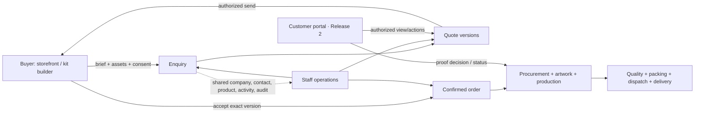
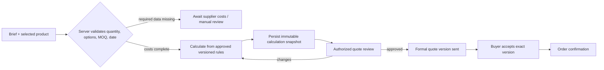
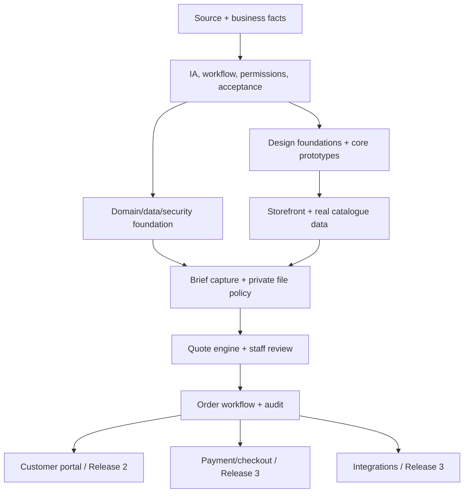

# Phase 0–2 Deliverables — Corporate Gifting Solutions

**Prepared:** 29 October 2026 · **State:** Planning complete, pending business/design-owner decisions  
**Inputs actually inspected:** user-pasted `Pasted text.txt` (3,012 lines); project folder; existing `Design.md` and `BUILD_PLAN.md`.  
**Not available in the inspected project:** source code, assets, business proposal, funding deck, catalogue, brand files, database, integrations, or deployment configuration. The pasted directive references these materials, but they were not present in the project folder. No other attachment contents are claimed as reviewed.

This document records Phases 0, 1 and 2 so a reviewer can approve the product direction before implementation. “Proposed” and “open” are deliberate labels; they do not establish unconfirmed business facts.

## Phase 0 — Source audit and project reconnaissance

### 0.1 Inventory and baseline

| Item | Finding | Status / consequence |
|---|---|---|
| Master Build Directive | Read from supplied pasted text; contains product definition, art direction, 23 templates, commercial rules, domain model, architecture, safety and phases | Authoritative input available for this planning pass |
| Business proposal | Referenced by directive but not supplied in the inspected folder | Commercial claims and model details remain unverified |
| Bank funding pitch deck | Referenced by directive; pasted text describes possible advantages such as flexible quantities, multiple vendors and local delivery | Do not publish as fact until source deck and business owner confirm |
| Global blueprint / UX / art direction | Blueprint and extensive UX/art-direction material are embedded in pasted directive | Reviewed as user-provided direction, not as validated business truth |
| Brand references / product photography | No local files found | Palette, typography and image treatment are hypotheses; visual/photo fit cannot yet be validated |
| Existing app/repository | Project folder contained only `Design.md` and `BUILD_PLAN.md` at inspection; `git status` reports not a repository | No code, route map, framework, data source or existing behavior to preserve; do not infer a stack from absent code |
| Build plan and design plan | Read current project docs | Updated by this deliverable; keep as planning artifacts |
| Integrations/infrastructure | None discovered in project folder | Provider, hosting, email, analytics, storage and payment choices remain open |

### 0.2 Source conflicts and ambiguities

1. **Accent color:** the directive proposes Persimmon `#E45B36`, while other embedded material contains a dark value `#241D19`; directive says the value is inconsistent. Keep both provisional. Do not freeze a token until source owner confirms intended hue and contrast tests are performed.
2. **Three products vs. three connected applications:** Release 1 should be a complete quote-led buying experience with lean internal operations. The full customer portal is placed in Release 2 in the directive. Preserve common identities and domain records, but do not imply customer accounts, online payment or automated tracking are launch capabilities until delivered.
3. **Pricing vs. quote-led business:** the material discusses indicative budget ranges and volume tiers, but requires server-side validation and no invented price. Phase 1 therefore selects quote-led launch; display budget bands or estimates only when data and rules are approved, clearly label them, and route incomplete costs to manual review.
4. **Lead time and delivery language:** local delivery/lead-time advantages are referenced, but no geographic coverage, SLA, supplier capability or guarantee was provided as an actual business fact. Show requested dates and confirmed commitments as separate concepts.
5. **Initial audience/geography:** Bengaluru, HR/procurement, startups and IT hubs are source-described focus hypotheses. Confirm service area, customer segments and priority occasions before public content is approved.
6. **Stack recommendations:** Next.js/React/TypeScript/Tailwind/PostgreSQL are recommendations in the directive, not findings about an existing application. Project baseline shows no code. Final stack is an architecture decision for Phase 4 after business/hosting constraints are confirmed.
7. **Tax, currency and payment:** INR/Indian formatting is recommended, but tax treatment, payment terms/provider, invoicing and legal/commercial process are unconfirmed. Keep tax configuration and payment collection out of scope until finance owner approves.

### 0.3 Assumptions and safe defaults

| ID | Planning assumption | Safe default | Consequence if wrong |
|---|---|---|---|
| A-01 | The first release must create useful leads before full automation | Quote-led public journey + lean internal pipeline; no direct checkout | Extra manual work may be needed until costs and fulfillment are reliable |
| A-02 | Initial public experience targets the Bengaluru corporate market | Use configurable service-area records and carefully scoped copy | Service pages/content may need adjustment after actual coverage is known |
| A-03 | Product and supplier facts are not yet available in project | No public product claims until approved data is supplied | Storefront can be designed but cannot be truthfully populated |
| A-04 | A company may have multiple authorized contacts | Model company and contacts separately with explicit access | Simpler initial workflows can still use one contact without schema redesign |
| A-05 | Customer account features come after first quote-led release | Start with enquiry reference and staff workflow; add identity later | Customers may initially use staff-mediated updates |
| A-06 | Quote pricing needs human review while supplier costs/rules are incomplete | Missing cost means “awaiting supplier costs” / manual review, never zero | Slower response, but prevents false commercial commitments |
| A-07 | Files may contain proprietary logos/artwork and personal contact information | Keep private; restrict access; define retention and scan process before accepting uploads | Upload feature may be delayed pending storage/security choices |

### 0.4 Initial risk register

| ID | Risk | Likelihood / impact | Mitigation / owner needed |
|---|---|---|---|
| R-01 | Unverified costs or supplier availability produce misleading quote | High / critical | Server-side cost completeness, snapshot and authorized review; finance/ops owner |
| R-02 | Marketing copy promises capability or delivery that operations cannot meet | Medium / high | Fact register and business sign-off for each claim; business owner |
| R-03 | Customer artwork/contact data is exposed or retained indefinitely | Medium / high | Private storage, least privilege, scanning, retention and deletion process; security/privacy owner |
| R-04 | Quote is mistaken for order or estimate for confirmed price | Medium / high | Explicit distinct state models and customer-facing labels across UI/API/notifications |
| R-05 | Pricing or order history changes when supplier/product data changes | Medium / high | Immutable sent/accepted quote and confirmed order snapshots |
| R-06 | No source assets or actual catalogue leads to generic/false product imagery | High / medium | Acquire real images; mark prototypes; no fake-inventory photography |
| R-07 | Team builds all routes as disconnected mock screens | Medium / high | Vertical slices and acceptance contracts; complete one real workflow end to end |
| R-08 | Wrong identity/access design exposes another company's records | Medium / critical | Server-side tenant/object authorization on every record operation; adversarial checks |
| R-09 | Tax/payment assumptions differ from actual commercial policy | Medium / high | Do not collect payment or publish tax-inclusive final totals until finance confirms |
| R-10 | `Design.md` palette conflicts with source accent | High / low | Keep accent provisional and test contrast in Phase 2 review |

### Phase 0 exit

**Ready to define product architecture:** yes, using the supplied directive and explicit assumptions. **Ready to finalize implementation stack, public claims, price rules or production design:** no. Those require repository/business assets and owners identified in the decision register below.

## Phase 1 — Product architecture and workflow definition

### 1.1 Product boundary and release plan

**Release 1 (launch foundation):** public discovery and product/occasion templates; truthful catalogue/contact; quote-led kit builder and request submission; staff enquiry pipeline, quote preparation/revision and order/fulfillment records sufficient to deliver manually; responsive/accessibility/error states; analytics only after privacy and event definitions are approved.

**Release 2:** secure customer accounts, saved briefs, quote history/versioning, artwork proof approval, order status and repeat-order requests.

**Release 3:** approved payments, fixed-price checkout for eligible catalog items, account pricing, supplier/fulfillment automation and advanced reporting. Release 3 is conditional on verified product, pricing, tax, delivery, and provider data.

### 1.2 Connected application boundary



Shared product, company, quote/order status semantics, file ownership and event history connect the public, staff and later customer applications. Public UI never receives supplier costs or staff-only notes.

### 1.3 Information architecture and page purpose

| App | Route | Primary task | Release |
|---|---|---|---|
| Public | `/` | Choose occasion/collection or start a brief | 1 |
| Public | `/collections` | Browse families | 1 |
| Public | `/collections/[slug]` | Compare products in a family | 1 |
| Public | `/products/[slug]` | Understand item, options and request quote | 1 |
| Public | `/solutions/[slug]` | Start from a gifting occasion/business need | 1 |
| Public | `/build-a-kit` | Assemble and review a structured requirement | 1 |
| Public | `/how-we-work` | Understand confirmed process and constraints | 1 |
| Public | `/about` | Assess real business and operations | 1 |
| Public | `/catalogue` | View/download a dated catalogue | 1 |
| Public | `/contact` | Ask a short question without losing brief context | 1 |
| Customer | `/quote/request` | Review and submit quote brief | 1 |
| Customer | `/quote/[id]` | Review request/quote state and next action | 1 baseline; authenticated capabilities follow Phase 2 |
| Customer | `/account/login` | Sign in/recover account | 2 |
| Customer | `/account` | Act on open quotes/orders | 2 |
| Customer | `/account/orders/[id]` | See confirmed order and progress | 2 |
| Customer | `/account/orders/[id]/artwork` | Approve exact proof or request changes | 2 |
| Staff | `/admin` | Prioritize actionable work | 1 |
| Staff | `/admin/enquiries` | Qualify, assign and follow up | 1 |
| Staff | `/admin/quotes/[id]` | Prepare/review/send versioned quote | 1 |
| Staff | `/admin/catalogue` | Maintain product/supplier facts and visibility | 1 |
| Staff | `/admin/orders/[id]` | Track handoff and fulfillment manually/with milestones | 1 |
| Staff | `/admin/customers` | Maintain company and authorized contacts | 1 |
| Staff | `/admin/reports` | See only defined and sourced measures | 1 foundation; meaningful metrics after data accrues |

Every route needs loading, empty, validation, failed request, success, unauthorized/not-found, expired, permission and unsaved-change handling where applicable. Route existence does not mean feature is automatically launch-ready.

### 1.4 Journey maps and acceptance outcomes

**Explorer:** Home/search → collection/occasion → browse/filter → product and constraints → kit/product brief → quote review → server-confirmed receipt → reference/next step. Acceptance: preserves selected products/filters/context, validates form server-side, keeps draft on failure, does not present estimate as quote.

**Decision-maker:** Occasion + requested date → quantity → budget or “not decided” → product selections or curation request → branding → packaging → destination → feasibility summary → company/contact → consent/files → submit. Acceptance: clear step progress; visible summary; backward navigation preserves entries; constraints explain next steps; no fabricated price/availability.

**Returning buyer (Release 2):** Sign in → quote/order list → inspect exact version and commercial terms → accept/decline/request clarification as allowed → approve exact artwork revision → track order → repeat-order request with current cost/date revalidated. Acceptance: company-scoped access; immutable approval proof; no silent quote-to-order conversion.

**Staff operational journey:** New enquiry → source/context retained → qualify and assign → identify missing info → obtain supplier data → draft quote → independent/authorized review → send snapshot → record customer decision → create confirmed order only from accepted exact version → procure/artwork/produce/quality/pack/dispatch/deliver → close or resolve exception. Acceptance: every transition has an authorized actor, timestamp, valid preconditions, audit record and recoverable failure path.

### 1.5 Commercial state model

```mermaid
stateDiagram-v2
  [*] --> EnquiryReceived
  EnquiryReceived --> Qualifying
  Qualifying --> Qualified
  Qualifying --> Closed
  Qualified --> QuoteDraft
  QuoteDraft --> NeedsReview
  NeedsReview --> QuoteDraft
  NeedsReview --> QuoteSent
  QuoteSent --> Accepted
  QuoteSent --> Rejected
  QuoteSent --> Expired
  QuoteSent --> Superseded
  Accepted --> OrderConfirmed
  OrderConfirmed --> Procurement
  Procurement --> ArtworkReview
  ArtworkReview --> Production: exact proof approved
  ArtworkReview --> ArtworkRevision: changes requested
  ArtworkRevision --> ArtworkReview
  Production --> QualityCheck --> Packing --> Dispatched --> Delivered --> Complete
```

Allowed variations are explicit by product/order. A quote acceptance action must reference a specific sent version. Order creation is a distinct audited transition. Expired or superseded versions cannot be accepted as current. Requested delivery, estimated date, confirmed date and delivery event remain separate fields/states.

### 1.6 Pricing lifecycle



No supplier cost = unknown, not zero. Indicative budget may be shown only if the formula/data are approved and label communicates the limits. Use decimal-safe money, documented rounding and currency; finance confirms INR/tax details.

### 1.7 Role and permission outline

| Capability | Anonymous buyer | Customer contact | Sales/ops staff | Quote approver/admin | System service |
|---|---:|---:|---:|---:|---:|
| Browse public catalogue / submit brief | Yes | Yes | Yes | Yes | No |
| View submitted record | Reference-scoped minimal status only if designed securely | Own authorized company record | Assigned/permitted work | All permitted records | For necessary processing |
| View supplier costs/internal margin | No | No | Only if role requires | Yes, explicitly authorized | Pricing service only |
| Draft/revise quote | No | No | If granted | Yes | No |
| Approve/send formal quote | No | No | No by default | Yes, policy-defined | No |
| Accept quote | No | Authorized contact | No | No | Record action only |
| Confirm/cancel order | No | Request/approve where policy permits | Per role | Authorized role | No implicit action |
| Approve artwork | No | Authorized contact | No | No | Record action only |
| Mark production ready | No | No | Authorized ops after required proof | Oversight | No implicit action |
| Manage users/roles | No | No | No | Admin only | No |

This matrix is a draft. Define least-privilege scopes and company authorization policy before authentication implementation. Enforce permissions server-side on every record access/mutation; route hiding alone is not security.

### 1.8 Domain model — first-pass relational boundaries

**Identity/access:** User, Role, Permission, Company, CompanyContact, CompanyMembership. A user can represent an authorized contact at one or more companies only if business policy allows.

**Catalogue:** Product, ProductVariant, Collection, Occasion/Solution, ProductCollection, ProductOccasion, Supplier, SupplierProduct, SupplierCostHistory, CustomizationMethod, PackagingOption, PricingRule, ProductAsset. Public product facts and private supplier/cost data have separate access projections.

**Brief/sales:** Enquiry, EnquiryActivity, SavedBrief, BriefItem, EnquiryAssignment, InternalNote, FileAsset. Preserve source, consent, requested date and original submitted content; changes append activity rather than erase it.

**Commercial:** Quote, QuoteVersion, QuoteLine, QuoteCostBreakdown, PricingSnapshot, QuoteApproval/Decision. Sent and accepted versions are immutable. Supplier cost/markup visibility is staff-only.

**Fulfilment:** Order, OrderLine, OrderEvent, SupplierPurchaseOrder, ArtworkAsset, ArtworkVersion, ArtworkDecision, QualityCheck, Shipment, DeliveryEvent, PaymentRecord, InvoiceRecord. Payment/invoice entities exist in the conceptual model but activation depends on policy/provider.

**Platform:** Notification, AuditEvent, ReportingEvent/definition as needed. Avoid an all-purpose JSON blob; use JSON only for versioned, validated snapshots where preserving calculation inputs is specifically needed.

Use database constraints, foreign keys, uniqueness, transactional boundaries, indexes based on observed query patterns, explicit deletion/retention policy and immutable commercial history. Draft only—physical schema belongs to Phase 4 after architecture decision.

### 1.9 Feature dependencies and launch critical path



Release 1 critical path is verified catalogue facts + real quote capture + server validation + staff visibility/review + safe order handoff. Portal, payment, and supplier automation are dependent, conditional follow-on work.

## Phase 2 — Art direction and design-system definition

### 2.1 Direction and unresolved evidence

**Working territory:** *The Objects of Appreciation* — a contemporary design journal, curated product catalogue and precise corporate commerce interface. Show object/material, relationship/occasion and operational competence together. Storefront is expressive; portal is composed and precise; operations is dense, keyboard-efficient and task-led.

**Phase 2 limitation:** no actual product photographs, brand files, logo or confirmed font assets were available in the project. Therefore this phase can define a design hypothesis and component rules, but cannot responsibly approve the final accent, serif, image treatment or finished hero composition. The next design review should use representative genuine products and compare three territories from the directive: editorial object design, contemporary color-blocked merchandise and restrained luxury packaging.

### 2.2 Token proposal (not locked)

| Semantic token | Provisional value | Use | State |
|---|---|---|---|
| `color.brand.oxblood` | `#641F32` | Brand moments, limited large surfaces, selected headings | Proposed |
| `color.canvas.chalk` | `#F3EFE7` | Main editorial canvas | Proposed |
| `color.surface.paper` | `#FFFFFF` | Product/background and high-clarity surface | Proposed |
| `color.accent.mineral` | `#9DB8C7` | Contextual informational emphasis | Proposed |
| `color.ink.graphite` | `#242422` | Primary text/operational interface | Proposed |
| `color.action.persimmon` | `#E45B36` | Functional action only | Unresolved; source also contains `#241D19` |
| `color.border.warm` | to derive from approved neutral palette | Dividers/structure | To define after contrast review |
| `color.state.success/warning/error/info` | define semantic values and paired text/icons | State cues across apps | To define and test |

Proposed type pairing: Cormorant Garamond Medium for selected editorial display headings, Manrope for body/interface; Instrument Serif + Manrope is an alternative to compare with photography. Verify font availability, licensing and rendering. Starting scale: hero 68–88 px desktop, section 42–56 px, product names 19–24 px, body 15–17 px, nav 13–14 px, small metadata 11–12 px sparingly; use fluid scaling and readable line length.

### 2.3 Grid, rhythm and layout rules

- Desktop foundation: 12 columns, max content width about 1,360 px, fluid gutters and margins around 48–72 px.
- Mobile foundation: 4 columns, 20–24 px margins; intermediate tablet changes composition instead of merely shrinking desktop.
- Spacing proposal: 4, 8, 12, 16, 24, 32, 48, 64, 96 px.
- Thin warm-neutral dividers, restrained radius, little/no decorative shadow; shadow only for functional layering.
- Align neighboring sections deliberately; use asymmetry for hierarchy, not as a default.
- Controlled composition vocabulary: editorial split hero; asymmetric collection index; product/material study; varied image grid; horizontal editorial sequence; specification/comparison table; story-to-function transition; focused kit workspace; operational data table; contextual summary panel.

### 2.4 Component inventory and state contract

**Brand/navigation:** SiteHeader, DesktopNavigation, MobileMenu, Breadcrumbs, Footer, EditorialLabel, SectionHeading.  
**Discovery:** ProductCard, CollectionTile, OccasionEntry, ProductGallery, ProductSpecification, ProductFilter, SortControl, Search, EmptySearchState.  
**Commerce/brief:** MOQNotice, AvailabilityNotice, QuantityInput, VariantSelector, BrandingOptions, PackagingOptions, BudgetControl, DeliveryDateField, KitSummary, StepNavigation, QuoteReview, FileUploader, UploadStatus, QuoteSubmission, ReceiptReference.  
**Portal:** StatusTimeline, QuoteVersionPanel, Price/terms table, ArtworkPreview, ProofVersion, ApprovalDecision, AccountNavigation.  
**Operations:** AdminShell, ActionQueue, EnquiryTable/RecordRow, FilterBar, AssignmentControl, ActivityTimeline, QuoteBuilder, CostBreakdown (private), VersionHistory, TransitionAction, OrderMilestone, RiskFlag, ReportDefinitionLink.  
**Shared feedback:** Field, HelpText, InlineError, Alert, Toast (noncritical only), Dialog, LoadingSkeleton, EmptyState, ErrorPanel, PermissionDenied, UnsavedChanges, ConfirmationPanel.

Each interactive component specifies default, hover, focus-visible, selected, disabled, loading, success and error as applicable; loading/errors are not merely color changes. Status always has text and icon/label where useful. Forms have explicit labels, meaningful validation, retained data on error, server-side outcome and screen-reader announcement. Data table mobile behavior has a defined alternative, not clipped tiny columns.

### 2.5 Page wireframe notes for core proof screens

1. **Homepage:** quiet nav → editorial split statement/real object → four product-family entry compositions → occasion-led path → tangible process explanation → useful catalogue/contact/brief close. One dominant action per viewport; avoid repeated equal card grids.
2. **Product detail:** desktop image gallery and information/configuration column; mobile gallery, key specs/constraints, options then a safe sticky quote action. Show what is included, known customization, minimum/availability status, requested-vs-confirmed delivery and quote next step.
3. **Kit builder:** stepper and contextual questions with persistent desktop summary; mobile summary disclosure and separate review step. Quantity/date/budget or unknown → product/recommendation → branding → packaging/destination → review → company/contact/files/consent → submit. Previous step preserves data; infeasibility explains a useful alternative.
4. **Quote review/submission:** complete brief, missing facts and estimate status up front; grouped company/contact/delivery; file state and consent; review, submit state, server-confirmed reference. Failure retains draft and offers retry.
5. **Operations overview:** “needs action” queue (new briefs, quotes requiring review, at-risk deadlines, proof approvals, payment/dispatch issues only when real data exists); each item links to a record. No ungrounded KPI cards.
6. **Quote workspace:** customer brief and source visible; costs and margin in staff-only panel; assumptions, version/validity, customer-facing notes separated; review/send transition deliberate and audited.

These are structural wireframe specifications, not finished UI mocks. High-fidelity review requires real product assets and brand owner decisions.

### 2.6 Motion and responsive interaction rules

Motion serves state change or orientation: subtle image alternate on hover, immediate summary updates, restrained editorial reveals. No scroll hijacking or essential content hidden behind animation. Respect reduced motion; every flow works without motion. On mobile: compact menu, one/two product columns by density, filters in accessible sheet, product gallery before details, collapsible builder summary, one-column quote form, prioritized admin records instead of dense microscopic tables. Sticky actions must not cover fields, validation, keyboard or focused controls.

### 2.7 Accessibility and design acceptance

Use WCAG 2.2 AA as design target. Review contrast for text, controls and focus; keyboard order; visible focus; landmarks/headings; label/instruction/error association; accessible dialogs/sheets; touch target usability; zoom/reflow; status announcements; alt text; reduced motion. Never rely on color alone. Design both validation and server/network errors.

**Phase 2 gate:** brand grammar demonstrably unifies storefront, portal and operations while different densities fit their tasks. Before visual sign-off, owner provides real photographs/logo, approves name/content facts, resolves accent and type, and reviews screen concepts at mobile and desktop. Current plan defines the review criteria but does not pretend this evidence was available.

## Consolidated decision register

| ID | Decision required | Proposed safe default / options | Owner | Needed by |
|---|---|---|---|---|
| D-01 | Are there other authoritative sources (proposal, deck, product catalog, brand guide)? | Provide/attach; until then only the pasted directive is verified | Business owner | Phase 0 complete |
| D-02 | Confirm company public name, actual service footprint and expansion plan | Keep “Corporate Gifting Solutions” as working name; location configurable | Business owner | Phase 1 content freeze |
| D-03 | Confirm which product families/occasions are currently serviceable and actual items | No public inventory or capability claims until signed-off data | Product/ops | Phase 2 prototype + Phase 5 content |
| D-04 | Define quote turnaround, quote validity and who can approve/send | Do not show SLA/expiry until confirmed; distinct approval authority | Sales/finance | Phase 1 workflow |
| D-05 | Define pricing formula, cost sources, margins, freight, tax, currency/rounding | Quote-led; incomplete inputs require manual review; tax configurable | Finance | Phase 1/Phase 6 |
| D-06 | Confirm accent `#E45B36` vs `#241D19`, approved palette and type/font licensing | Compare 3 directions against real products; keep token unlocked | Brand owner | Phase 2 sign-off |
| D-07 | Confirm identity model, company membership and customer-facing quote access | Secure provider, tenant-scoped object access; accounts in Release 2 | Product/security | Phase 1/Phase 4 |
| D-08 | Define artwork formats/size, storage, scanning and retention | Private storage and quarantine before uploads enabled | Ops/security | Before Phase 6 upload |
| D-09 | Confirm actual order transitions, procurement/artwork sequence, cancellation and exceptions | Explicit state rules with manual fallback; allow authorized variants | Operations | Phase 1 workflow |
| D-10 | Confirm payment provider, terms, invoice/refund/reconciliation | Defer payment/checkout until finance approves | Finance | Before Phase 9 |
| D-11 | Confirm hosting, integrations, catalogue CMS and analytics consent | Inspect/propose only after requirements; no provider assumed | Tech/business | Phase 4/10 |
| D-12 | Approve privacy notice, contact collection, data retention and analytics policy | Minimize data; no sensitive analytics; responsible review | Privacy/business | Before launch |

## Requirements traceability register — starter set

Priority: **P0** launch/trust-critical; **P1** core value; **P2** follow-on. Status is **Planned** unless explicitly marked open/deferred.

| ID | Requirement (source section) | Class / problem addressed | Implementation surface | Acceptance criteria | Priority / dependency / status |
|---|---|---|---|---|---|
| TR-001 | Build connected storefront, customer portal, operations app (§1) | Explicit; one lifecycle | Shared domain + three route groups | Same company/product/quote/order identities; no duplicate system of record | P0 / domain model / Planned |
| TR-002 | Initial market Bengaluru; avoid hardcoding (§1) | Explicit; local relevance without lock-in | Service area data/content | Service area configurable and claims verified | P1 / D-02 / Open |
| TR-003 | Four product families and multi-occasion relationships (§1) | Explicit; discoverable catalogue | Product/collection/occasion schema | One product can be in multiple collections/occasions without duplication | P1 / approved catalog / Planned |
| TR-004 | Separate standardized and customized buying paths (§1) | Explicit; right commercial path | Product eligibility + quote flow | Checkout disabled unless eligibility/data approved; custom requests use quote path | P0 / pricing policy / Planned |
| TR-005 | Estimate ≠ quote ≠ order (§1, §7) | Explicit; prevent false commitment | UI/API/domain/notifications | Status and transitions remain distinct everywhere | P0 / workflow / Planned |
| TR-006 | Never fabricate suppliers, testimonials, costs, MOQ, delivery claims (§00) | Explicit safety rule | Content/catalogue/admin | Public records published only from approved source data | P0 / fact register / Planned |
| TR-007 | Preserve source/context and trace every requirement (§00) | Explicit; maintain scope | Traceability register and enquiry | Requirement records link to delivery and source; enquiry retains origin/context | P0 / Phase 0 / In progress |
| TR-008 | Home, collection and product discovery templates (§4, §6.1–6.4) | Explicit; find appropriate items | Public routes | Real data, useful specs/options, filters, states and quote CTA work | P1 / product data / Planned |
| TR-009 | Occasion/solution landing pages (§4, §6.5) | Explicit; start from business need | `/solutions/[slug]` | Occasion connects to multiple relevant products and CTA | P1 / catalog relations / Planned |
| TR-010 | Kit builder progressive disclosure, summary, back without loss (§6.6) | Explicit; reduce effort | Builder | User can backtrack; summary reflects choices; date/budget unknown allowed | P0 / brief schema / Planned |
| TR-011 | Builder constraints show sensible next step (§6.6) | Explicit; avoid impossible promises | Server feasibility result/UI | MOQ/lead-time/options constraints explained; no silent infeasible submit | P0 / real rules / Planned |
| TR-012 | Quote request prefills configuration, validates and resists duplicate submit (§6.11) | Explicit; complete lead safely | Quote request endpoint/UI | Server validates; idempotent submission; failed save retains draft | P0 / persistence / Planned |
| TR-013 | Confirm receipt only after persistence; reference and accurate next step (§6.11 and submission guidance) | Explicit; trust | Submission response/notification | No success before server confirms saved record; no unsupported response SLA | P0 / email optional / Planned |
| TR-014 | Customer quote shows version/status/assumptions/expiry/next action (§6.12) | Explicit; clarity | Quote detail | Status label accurately reflects backend and missing pricing | P0 / quote lifecycle / Planned |
| TR-015 | Secure authentication/recovery and deny unauthorized data (§6.13) | Explicit; confidentiality | Account routes/data layer | Guessing IDs/cross-company access does not reveal records | P0 / provider + membership / Release 2 |
| TR-016 | Artwork action refers to exact version and actor/time (§6.16) | Explicit; prevent production ambiguity | Portal proof + order gate | Audited approve/request changes against immutable proof version | P0 / portal / Release 2 |
| TR-017 | Operations queue surfaces actionable work and linked records (§6.17) | Explicit; staff prioritization | `/admin` | Every operational count/flag drills into underlying records | P1 / real records / Planned |
| TR-018 | Quote workspace uses real costs, approved rules, privacy and versions (§6.19) | Explicit; pricing integrity | Quote domain/admin | No missing cost as zero; immutable sent quote; staff-only cost fields | P0 / finance policy / Planned |
| TR-019 | Supplier cost changes do not rewrite historical quote/order (§6.20) | Explicit; preserve commercial record | Cost history + snapshots | Historical sent/accepted terms unchanged after catalog cost edit | P0 / schema / Planned |
| TR-020 | Controlled, auditable but variable fulfillment path (§6.21) | Explicit; reliable delivery | Order lifecycle/admin | Invalid transitions blocked; allowed variations policy-configured; exception recorded | P0 / ops mapping / Planned |
| TR-021 | Reports have definitions and source query (§6.23) | Explicit; prevent fake KPIs | Reports | Metric definition/date range/source visible; no fabricated values | P1 / data accrual / Planned |
| TR-022 | Server validates pricing inputs and persists calculation snapshot/version (§7) | Explicit; safe quote math | Pricing service/database | Decimal-safe calculation; snapshot inputs and rule version; authorized quote review | P0 / approved formula / Planned |
| TR-023 | Model relational entities and preserve constraints/history (§8) | Explicit; integrity | PostgreSQL default recommendation | Foreign keys, transactions, audit and controlled migrations; final engine after ADR | P0 / stack ADR / Planned |
| TR-024 | Modular architecture, server-side commercial logic and protected admin (§9) | Explicit recommendation; maintainability/security | App architecture | Pricing/access/order rules unavailable to client-only authority; no unprotected admin | P0 / Phase 4 / Planned |
| TR-025 | Establish tokens, components, interaction/responsive rules (§10–12) | Explicit; consistent usability | Design system | Components have applicable focus/loading/error/disabled states and responsive behavior | P1 / Phase 2 / In progress |
| TR-026 | Respect reduced motion and make function work without animation (§11) | Explicit; accessibility | Shared interaction system | Reduced-motion setting removes nonessential motion; no hidden essential action | P1 / design system / Planned |
| TR-027 | Protect privacy, uploads, secrets and reliability (§13) | Explicit; protect business/customer data | Auth, storage, environment, monitoring | Least privilege, private assets, validation/scanning, retention, redacted logs, backup plan | P0 / policies/provider / Planned |
| TR-028 | Notifications use authoritative state and integration failures recover (§14) | Explicit; avoid false status | Notification service | Idempotent events; retry/manual fallback; failed integration does not corrupt record | P1 / providers / Planned |
| TR-029 | Phase 0 source audit, traceability, assumptions, risks (§15) | Explicit; make decisions inspectable | This document + registers | Source inventory, assumptions, conflicts, initial risks and gate recorded | P0 / directive available / Complete with missing-source caveat |
| TR-030 | Phase 1 app/routes/journeys/lifecycles/roles/entities/dependencies/criteria (§15) | Explicit; define build before code | This document | Reviewer can trace public brief to fulfilled order and identify role authority | P0 / owner decisions / Proposed; decisions open |
| TR-031 | Phase 2 visual test, tokens, grid, components, responsive and core screens (§15) | Explicit; align brand and operations | `Design.md` + this doc | Core screens share brand grammar and differ by task; photo/accent review recorded | P1 / real assets / Proposed, not visually signed off |

## Phase 0–2 sign-off checklist

- [x] Inspect the project folder and current planning docs.
- [x] Read the supplied directive end-to-end by sections; record that other named source documents were not provided in the inspected project.
- [x] Record repository baseline (planning docs only; no code/git repository detected).
- [x] Capture source conflicts, assumptions, risks, domain boundaries and route map.
- [x] Define buyer and staff workflows, state boundaries, first-pass role matrix, conceptual entities and feature dependencies.
- [x] Define design hypothesis, provisional tokens, component inventory, page wireframes and accessibility/responsive criteria.
- [ ] Business owner supplies/approves business proposal, deck, real catalogue/photos and public claims.
- [ ] Business/finance/ops/security owners decide D-02 through D-12 where applicable.
- [ ] Brand owner reviews three territories with actual product imagery, resolves accent/type and signs visual direction.
- [ ] Convert proposed architecture into approved ADR and implementation-ready acceptance criteria after decisions above.

**Phase 0–2 outcome:** The product, first-release scope, workflows and design review criteria are defined enough to proceed to prototype/validation planning. They are not enough to safely publish claims, quote prices, select production providers or finalize high-fidelity visual tokens. These require the named owners and real inputs; do not hide the gap by making up details.
